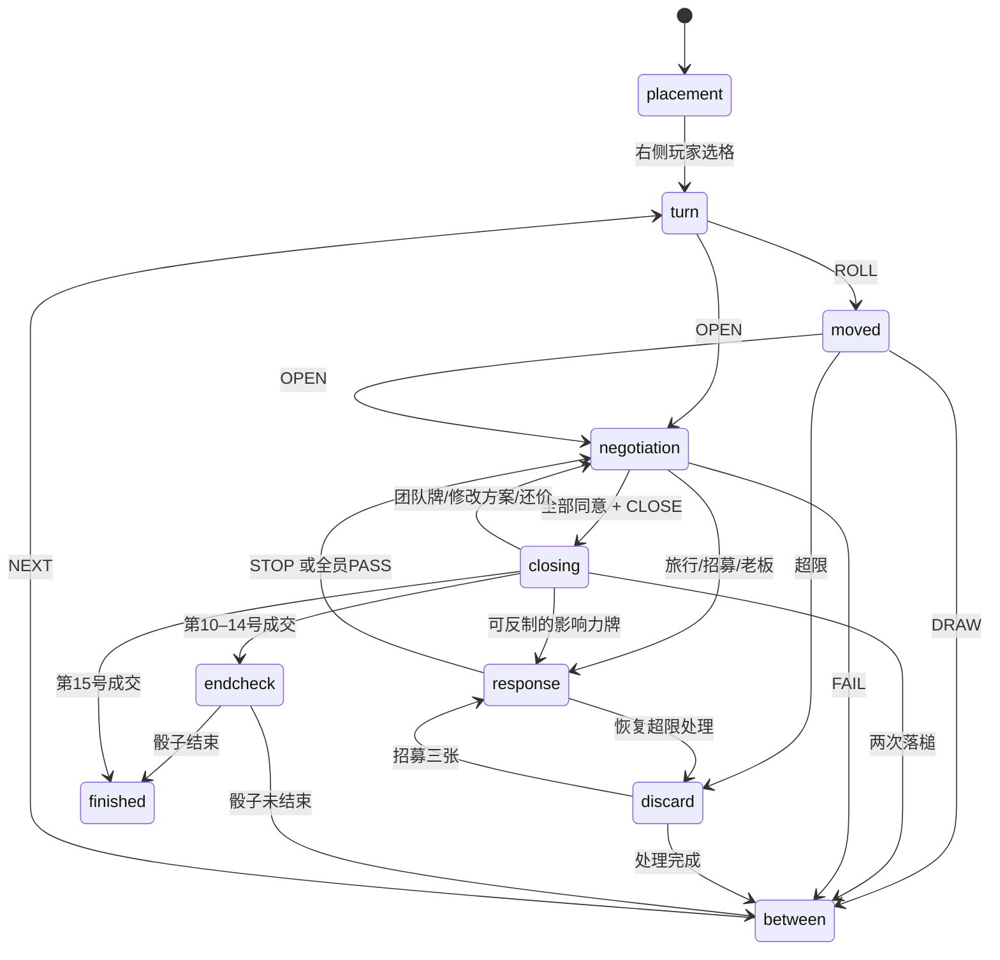

# 规则引擎与玩家适配接口

## 状态与命令

`createGame(config, seed, variants)` 生成完整对局。`applyAction(state, action)` 克隆状态、检查规则、应用命令并返回新状态；无效动作抛出 `RuleError`，输入对象不会改变。React、定时器、本地文件、网络和音效均不进入引擎。

所有随机结果来自序列化的 32 位 PRNG。相同起始种子与命令序列可以复现相同牌序、投资人分配和骰子。不要将种子、未抽取牌或他人手牌交给决策模块。

`observe(state, self)` 返回 `Observation`：自己的手牌、公开团队/旅行/归属/报价/历史、对手手牌张数、牌库张数以及当前阶段；隐藏种子、牌库内容、他人手牌和未终局时他人现金合计。公开交易记录仍允许玩家凭记忆推断现金，这是实体规则允许的行为。

```ts
import { createGame, observe, applyAction } from "../src/engine/game";
import { basicAgent } from "../src/agents/basic";

let state = createGame(players, 12345);
const action = basicAgent.decide(observe(state, playerId));
if (action) state = applyAction(state, action);
```

每次出牌、收益结算都维持 98 张唯一影响力牌和现金守恒。牌可能位于牌库、弃牌堆、手牌、桌面团队、投资人上的旅行牌或待反制区。

## 阶段



超限处理保存 `discardResume`，也可以返回 `endcheck`。第 10 号起降低手牌上限的变体会为所有超限玩家排队处理。

## 投资组合与承诺

一个交易格由若干互不重叠的颜色组构成，每组有 `teams` 与 `count`。选择具体 `Resource.id`，不能仅选择颜色：同色投资人和不同玩家的团队牌可以竞争，旅行也只针对其中一个具体资源。

`validSelection()` 检查全部分组、不同颜色、所有权与旅行状态。老板拟定 `Proposal`，包含具体资源、按玩家分配的现金和已接受名单。修改方案必须重新确认；旅行、招募和换老板使旧方案失效。团队牌公开不自动破坏已有合同，但会取消落槌阶段。

老板保留总额减去对其他玩家的所有支付。资源提供者和获得支付的其他玩家都要确认；老板自动同意。成交完成后由引擎一次性付款，无法反悔或用存量现金补贴。标准规则允许未提供团队的人取得约定支付。

`Pending` 在真正改变归属、旅行状态或老板前接收 STOP。STOP 不创建新的 Pending，避免反制链错误。三张招募被取消时依然消耗三张牌。

## 基础电脑

`DecisionAgent.decide(observation): Action | null` 是同步基础接口。`null` 表示当前无需操作，不是跳过整个回合。电脑只读取公开信息和自己的牌：

- 枚举合法组合，偏好自己的投资人以及较低支付。
- 按团队数估算参与报价，强势性格略加价。
- 公开有价值的团队，三张招募永久扩大归属。
- 被排除且有筹码时抢老板或旅行威胁；用 STOP 防卫自己的资源/老板地位，必要时保护交易所需第三方。
- 同意合适方案，拒绝预算不可行的方案，通过正常动作完成整局。

“出牌才能收款”变体中电脑优先公开团队取得付款资格；无法取得资格时可以选择免费支持，保留手中资源。

## 将来接 LLM

新增异步适配器，例如 `decide(observation, signal): Promise<Action | null>`，沿用动作协议与引擎校验。模型只得到 `observe` 结果。建议提交动作时带预期 `state.revision`，过期响应丢弃并重新观察。把 `CHAT` 当普通不可信文本，不允许对方的发言改变系统规则。引擎始终是合法性裁判，模型不能修改状态、骰子、现金或牌库。

当前没有请求任何模型服务，也没有 API 密钥入口。

## MyGo / 桌面封装

`npm run build` 得到相对路径静态产物，可嵌入 WebView。保留 `engine` 与 `agents` 原样；将 App 中的 localStorage 包成 `StorageAdapter` 后替换为 Go 的 JSON 文件持久化；将电脑定时调度替换为 Worker 或 Go bridge。Web Audio 是可选项，WebView 不支持时不影响游戏。

如扩展为联机，应由服务器独占真实 `State` 和随机源，客户端只收各自 `Observation`；用版本号串行化实时出牌并在服务端执行响应窗口。现有同屏版本的 JSON 导出包含全部牌，不具备联机防作弊能力。
