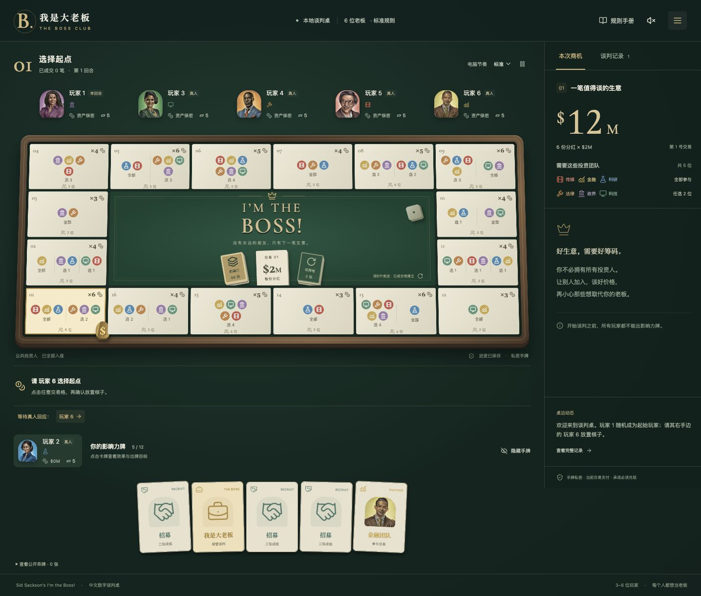

# 《我是大老板》中文规则与游玩手册

适用：本项目《我是大老板 · The Boss Club》浏览器版及 MyGo 客户端 1.0.0。支持 **3～6 个玩家席位**，可混合真人与电脑，真人共用一台设备游玩。

规则依据：Sid Sackson 设计的 *I'm the Boss!*，以 [2023 年版英文规则书](https://gamers-hq.de/media/pdf/26/0e/cf/ITB-Rules-public.pdf)为主要来源。本手册按中文玩家的学习顺序重新组织、解释规则；“客户端约定”会明确标注，便于区分原版规则与数字实现。

第一次玩，先读第 1～5 节，再按第 11 节操作。遇到争议可查第 7～9 节及第 14 节。

## 目录

1. [这是一个什么游戏](#1-这是一个什么游戏)
2. [五分钟理解核心玩法](#2-五分钟理解核心玩法)
3. [认识棋盘、投资人和卡牌](#3-认识棋盘投资人和卡牌)
4. [开局准备](#4-开局准备)
5. [你的回合怎么进行](#5-你的回合怎么进行)
6. [如何谈判与分配收益](#6-如何谈判与分配收益)
7. [五类影响力牌的完整规则](#7-五类影响力牌的完整规则)
8. [成交、失败与下一回合](#8-成交失败与下一回合)
9. [游戏何时结束、谁获胜](#9-游戏何时结束谁获胜)
10. [一笔交易的完整示例](#10-一笔交易的完整示例)
11. [浏览器和客户端操作指南](#11-浏览器和客户端操作指南)
12. [八种可选规则变体](#12-八种可选规则变体)
13. [给新玩家的谈判建议](#13-给新玩家的谈判建议)
14. [常见问题与特殊情况](#14-常见问题与特殊情况)
15. [一页速查](#15-一页速查)
16. [附录：16 个商机格](#16-附录16-个商机格)
17. [规则来源与客户端约定](#17-规则来源与客户端约定)

## 1. 这是一个什么游戏

《我是大老板》是一款以**自由谈判、争夺交易主导权、分配现金**为核心的桌游。原版标示 3～6 人、14 岁以上、约 60 分钟以上；实际时长取决于谈判速度。

你代表一个或多个投资团队。每个商机都要求特定团队合作，凑齐条件并谈好价钱，才能从银行取得收益。

发起谈判的人最初是这笔交易的“老板”。老板选择合作对象、提出分红方案，成交后留下支付他人之外的余额。其他玩家可以要求报酬、拿出替代团队、破坏合作，甚至打出“我是大老板”牌接管谈判。

**最终现金最多的人获胜。** 不是当老板次数最多、拥有投资人最多或成交最多的人获胜。这些都是挣钱的手段。

一名玩家可以同时提供多个团队；一个团队也可能有多个竞争报价者。你要判断：自己是否不可替代、别人能否找到更便宜的替代者，以及这笔钱是否值得消耗手里的牌。

## 2. 五分钟理解核心玩法

先记住以下七件事：

1. **看商机条件。** 棋子所在格决定需要哪些团队，以及银行支付几份分红。
2. **算本次总额。** 商机格的分红份数 × 当前交易牌的每份金额，就是本次可分配的总收益。
3. **老板找人合作。** 自己拥有的投资人可以直接提供支持；缺少的颜色要靠团队牌或与别人谈条件。
4. **任何玩家都能干预谈判。** 谈判开始后，不必等自己的常规回合，便可报价或使用合法影响力牌。
5. **老板身份会变。** “我是大老板”牌可以抢走谈判主导权，旧方案可能需要重新谈。
6. **真正成交才发钱。** 支持齐全、条件谈妥、完成落槌之后，所有约定付款必须兑现。
7. **成功交易越到后面，越可能结束游戏。** 第 10 号交易牌起开始终局判定，第 15 号成交后必定结束。

### 一个最简单的例子

某格要求蓝色科研与红色传媒，支付 3 份分红。当前每份值 $2M，因此总收益是 **$6M**。

你是老板，控制蓝色投资人；另一名玩家控制红色投资人。你提出“给你 $2M，我留 $4M”，对方接受。如果无人成功干预，成交时银行支付 $6M，你得到 $4M，对方得到 $2M。

如果另一人公开一张红色团队牌，愿意只拿 $1M，你便有了替代报价；但原来的红色投资人持有者也可能用牌改变局面。

这里的 **M 表示百万美元**：$1M = 100 万美元，$6M = 600 万美元。

## 3. 认识棋盘、投资人和卡牌

### 3.1 六个投资团队

| 颜色 | 客户端名称 | 代表领域 |
| --- | --- | --- |
| 红色 | 传媒 | Media |
| 黄色 | 金融 | Finance |
| 蓝色 | 科研 | Research Science |
| 橙色 | 法律 | Legal Affairs |
| 紫色 | 政界 | Politics |
| 绿色 | 科技 | Technology |

**蓝色科研与绿色科技是两个不同团队**，不能互相替代。颜色与图标共同帮助你识别团队。

### 3.2 投资人和团队牌不是同一种东西

| 项目 | 投资人牌 | 团队牌 |
| --- | --- | --- |
| 总数 | 每种颜色 1 位，共 6 位 | 每种颜色 4 张，共 24 张 |
| 平时在哪里 | 公开放在持有者面前；未分配的在公共区 | 未打出时在私人手牌中 |
| 如何参加交易 | 持有者同意使用即可 | 必须先从手牌公开打出 |
| 成交后 | 保留，可参加以后交易 | 实际用于成交则弃置；未使用且仍在桌上则回手 |
| 能否被招募 | 可以 | 不可以 |
| 被旅行牌命中 | 本轮不能参加，谈判结束后恢复 | 团队牌与旅行牌一起弃置 |

同色团队牌可以替代同色投资人。例如，别人的蓝色投资人要价太高，你可以公开蓝色团队牌，由自己提供蓝色支持。

**同一笔交易每种颜色只能选一个具体代表。** 两张红色团队牌不能当成两个不同颜色，也不能替代“红色＋蓝色”的条件。

投资人不是固定绑定玩家的角色。招募会改变投资人的所有权，你可以拥有多个投资人，也可能一个都没有。

### 3.3 棋盘上的商机

棋盘有 16 个商机格。每格规定：

- 必须提供哪些团队，或从某组团队中任选几个。
- 总共需要多少个不同团队。
- 成交后支付多少份分红。

例如，第 01 号商机要求：**红、黄、蓝全部参加，再从橙、紫、绿中选两个**，合计 5 个不同团队，支付 6 份分红。

分组条件要分别满足。第 11 号商机要求“绿／橙选一、红／紫选一、蓝／黄选一”，并不是六种颜色任意选三。

### 3.4 交易牌与收益

15 张交易牌从 #1 到 #15 排列，顶部那张决定当前每份分红的金额。

| 当前交易牌编号 | 每份分红 |
| --- | --- |
| #1～#3 | $2M |
| #4～#6 | $3M |
| #7～#9 | $4M |
| #10～#15 | $5M |

**本次收益 = 商机格分红份数 × 每份分红金额。**

例如，当前是 #6，所在格支付 4 份分红，总额就是 4 × $3M = **$12M**。这 $12M 可以谈成 $7M、$3M、$2M 等分法，并不要求每人的收入是 $3M 的整数倍。

只有成功成交才会使用一张交易牌：把它翻面盖住刚完成的商机，该格此后不能再次交易。

### 3.5 不要混淆三种编号

| 名称 | 含义 | 什么时候变化 |
| --- | --- | --- |
| 回合 | 轮到某位玩家选择行动的一次机会 | 一次行动及其后续处理完成后推进 |
| 商机格编号 | 棋盘上某个固定位置，例如第 07 号商机 | 棋子移动到别的格子时改变 |
| 交易牌编号 | 当前使用 #1～#15 中的哪一张牌 | 成交后换下一张；失败和补牌不变 |

比如“第 20 回合，在第 07 号商机上，尝试完成 #5 交易”完全正常。

### 3.6 其他组件与公开信息

原版共有 98 张影响力牌：团队 24、旅行 21、招募 33、老板 10、STOP 10；另有棋子 1 枚、六面骰 1 颗、现金牌 110 张。数字版自动管理银行、洗牌、移动与计算。

投资人归属、已经公开的团队牌、旅行状态及已出牌的弃牌堆属于公开信息。手牌内容保密。

原版要求现金留在桌上，但允许叠放，不允许别人触碰或清点。客户端对外隐藏精确现金合计，你可以看自己的钱，终局时统一公开；公开成交记录仍然可以帮助别人估计你的收入。

## 4. 开局准备

1. **安排 3～6 个席位。** 客户端至少需要一名真人，其余可以是真人或电脑。
2. **随机分配投资人。**

   | 玩家人数 | 每人起始投资人 | 公共区投资人 |
   | --- | --- | --- |
   | 3 人 | 2 位 | 0 位 |
   | 4 人 | 1 位 | 2 位 |
   | 5 人 | 1 位 | 1 位 |
   | 6 人 | 1 位 | 0 位 |

3. **洗混影响力牌，每人发 5 张。** 剩余牌组成牌库；不要向别人展示手牌。
4. **排列交易牌。** 标准游戏 #1 在最上方、#15 在最下方；短局变体会移除部分牌。
5. **所有人的起始现金都是 0。** 实体游戏指定一名银行管理员，客户端由系统代办。
6. **随机选起始玩家。** 由其右手边的玩家把棋子放在任意一个商机格上，然后起始玩家开始行动。

公共区投资人暂时不属于任何玩家，**必须先被招募才可以参与交易**。

第一次游玩可以使用默认的“一名真人＋三名电脑”，暂不启用八项可选变体，先熟悉标准流程。

## 5. 你的回合怎么进行

### 5.1 回合开始时，只能二选一

**选择 A：就在当前格发起谈判。**

宣布开始这笔生意，你成为初始老板，直接进入谈判。

**选择 B：先掷骰，再移动。**

按骰子点数顺时针前进；已经被交易牌盖住的格子跳过，不计入移动步数。移动到新格后，再二选一：

- 在新格发起谈判；或者
- 抽取 3 张影响力牌，处理超限后结束回合。

因此，一次常规回合只有三条路线：

```text
回合开始
├─ 原地开始谈判 → 成交或失败 → 结束回合
└─ 掷骰移动一次
   ├─ 在新格开始谈判 → 成交或失败 → 结束回合
   └─ 抽 3 张牌 → 处理手牌超限 → 结束回合
```

**不能站在原地直接补牌；不能补牌后接着谈判；也不能在同一回合反复掷骰挑位置。**

### 5.2 谈判什么时候开放

在当前玩家宣布开始谈判之前，其他玩家不能通过发言影响其选择，也不能打影响力牌。

谈判一旦开始，所有玩家都可以参与：报价、争取合作、公开团队、出牌干预。这里没有“依次轮流出牌”的固定顺序。

客户端为了处理同屏操作，把旅行、招募、抢老板之后的 STOP 机会单独作为响应窗口；先处理这次出牌，再继续自由谈判。

### 5.3 手牌上限与补牌

标准上限为 **12 张手牌**。超过上限时，立即选择：

- 弃掉超出的牌，直到剩 12 张；或者
- 如果有三张招募牌和合法目标，打出一次三张招募，再检查是否仍超限。

超限处理是谈判外可以进行招募的特殊时机。其他玩家仍能用 STOP 取消招募；三张招募牌即便被取消也已经消耗，因此可能仍足以解决超限。

桌上公开的团队牌不算手牌，但谈判结束后返还的团队牌可能再次造成超限，也需要处理。

没有“每回合自动补一张”或“成交后自动补牌”的规则。常规补牌必须走“掷骰移动 → 抽牌”路线。牌库用完时，把弃牌堆洗混为新牌库；客户端在牌库和弃牌堆都不足时，只能抽到实际可用的牌。

## 6. 如何谈判与分配收益

### 6.1 老板要凑齐哪些东西

老板必须为当前商机选出一套符合全部分组条件的团队代表。代表可以来自：

1. 自己控制的投资人。
2. 自己已经公开打出的团队牌。
3. 其他玩家愿意提供的投资人。
4. 其他玩家已经公开打出、愿意提供的团队牌。

自己提供的代表自动获得自己的支持。其他人的代表通常需要谈好价格，并得到持有者同意。

老板不一定亲自提供投资团队。如果能说服其他玩家提供完整组合，你仍然可以作为老板组织这笔交易。反过来，如果你独自控制全部所需代表，也可以独立完成交易，但别人仍有干预机会。

### 6.2 团队牌必须先亮出来

投资人是公开资源，可以直接报价。想用手里的团队牌参与，必须先把牌公开放到自己面前，才能以这个代表谈条件。

团队牌一旦公开，即使老板嫌贵、不选你，也不能立刻收回。它留在桌上等待这轮谈判结束，或被旅行牌送走。

多个玩家可以竞争同一个颜色的供给。老板最终选择一个具体代表，而不是把同色资源全部收入交易。

### 6.3 可以怎样报价

你可以说“我要一份分红”，也可以要求其他金额。标准规则没有强制均分，没有规定老板必须赚得最多，也没有规定提供代表的人最低必须拿多少钱。

例如，$12M 的交易可以约定：老板 $5M，另外两位分别 $4M、$3M。也允许某位参与者同意收入为 0。

本客户端统一以 **$1M 为最小金额单位**，报价和分配输入非负整数。金额必须来自这笔交易的收入，不能借钱、提前付款，或拿自己以前赚的钱补足本次分配。

基本规则也不要求所有收款人都提供团队：例如，可以约定付钱换取某人的配合。客户端允许把金额分给未提供代表的玩家，但这种约定不会剥夺其成交前依法出牌的机会；启用“出牌才可分红”变体后，还有额外收款资格限制。

### 6.4 报价、同意和成交是三件事

- **报价**：表达“我想拿多少”，还没有形成付款义务。
- **同意方案**：接受当前代表组合及分配；在真正成交前，局面仍可能变化。
- **落槌成交**：交易完成，约定付款必须执行，不能临时少付或赖账。

在客户端，老板填写的是各人的本次收入；老板自己的收入由系统按余额计算。写在聊天框里的话不会自动改变分红，必须落实到正式分红方案中。

标准模式下，方案使用的代表持有者，以及其他获得付款的玩家，都需要确认。既不提供代表、也不收款的玩家不需要批准这个方案，但仍可以通过卡牌干预，并在最后的落槌确认环节回应。

### 6.5 局面变化以后怎么办

在正式成交前，可以重新议价。客户端允许参与者“撤回同意，重新议价”，老板也可以修改代表和金额、重新发送方案。

抢老板、招募改变投资人归属、旅行成功使代表失效等情况，都可能使原方案无法继续。应以界面显示的当前老板、当前代表和最新方案为准，重新确认。

单纯公开一张替代团队牌，不等于自动替换当前方案里的代表；老板仍需主动选择是否使用它。

## 7. 五类影响力牌的完整规则

### 7.1 团队牌：24 张

每种颜色 4 张。打出后代表该颜色的一个团队成员，可以替代同色投资人参与交易。

- 只能代表牌面指定的颜色。
- 必须公开打出后才能参与谈判。
- 打出者控制这张牌，别人需要与其谈条件。
- 成交时，选入最终组合的团队牌弃置。
- 没被使用、并且仍在桌上的团队牌，在谈判结束时回到原打出者手中。
- 团队牌不能被招募，也不能直接用 STOP 取消其打出。

如果你同时有同色投资人和同色团队牌，通常可以选择用投资人完成交易，让没有使用的团队牌回手。但必须在成交方案里选对具体代表。

### 7.2 旅行牌：21 张

六种颜色各有 3 张专用旅行牌，另有 3 张灰色万能旅行牌。

- 有色旅行牌只能针对同色代表。
- 万能旅行牌可以针对任意颜色。
- 目标必须是一个**具体投资人或一张已经公开的团队牌**，不能针对别人手里的未知牌。
- 对一个代表使用旅行牌，不会让该颜色的所有代表一起失效。

被 STOP 取消时，目标不受影响。未被取消时，按目标类型处理：

| 命中的目标 | 结果 |
| --- | --- |
| 投资人 | 把旅行牌放在投资人上；本轮谈判不能使用该投资人。谈判无论成功或失败，结束后弃掉旅行牌，投资人恢复 |
| 已公开团队牌 | 团队牌和旅行牌一起立即弃置；这张团队牌不会在轮末回手 |

例如，你把某人的红色投资人送去旅行，其他人仍然可以公开红色团队牌，提供红色支持。

客户端也允许选择自己的在场代表作为旅行目标；原书双人／温和玩法特别提到了用这种方式阻止交易。

### 7.3 招募牌：33 张

招募牌必须**三张同时打出**。一张或两张不能发动招募。

一次三张招募可以取得一位投资人的所有权：把另一名玩家的投资人移到自己面前；4 人或 5 人开局尚有公共投资人时，必须先招募公共投资人。

- 只要公共区还剩投资人，就不能跳过它去抢别人的投资人。
- 一组三张只取得一位投资人。
- 只能招募投资人，不能招募团队牌。
- 不能招募已经属于自己的投资人。
- 招募成功后，所有权变化会保留到以后各轮，除非该投资人又被别人招募。
- 对方不需要同意，但任何玩家都可以立即打 STOP 阻止。
- 如果被 STOP，三张招募牌和 STOP 全部弃置，投资人不转移。

客户端允许招募正在旅行中的投资人，但旅行状态会跟着投资人保留到本轮结束，不能通过转移所有权提前解除。

**谈判最终失败，不会撤销已经成功的招募。** 团队牌回手与投资人归属恢复是两回事。

### 7.4 “我是大老板”牌：10 张

打出老板牌并且未被 STOP，打出者取代原老板，接管当前谈判。

- 这不是另开一笔交易：棋子位置、当前交易牌和总收益不变。
- 已公开的团队牌继续留在各自持有者面前。
- 已经生效的旅行状态继续有效。
- 投资人所有权不会仅因换老板而改变。
- 旧老板仍然可以谈判、出牌、提供代表和收款。
- 可以重新谈全部分配条件；客户端会要求新老板提出新方案。
- 一轮谈判中可以多次抢老板，以最后成功取得老板身份的人为准。

如果甲打出老板牌，乙用 STOP 取消，甲没有取得老板身份。其他玩家仍可在响应结束后打出新的老板牌。

标准规则的下一个回合从**最终老板左手边**开始。因此，抢老板也可能改变回合顺序，让某些玩家这一轮排队被跳过。启用“固定回合顺序”变体后才不受这一变化影响。

### 7.5 STOP 牌：10 张

STOP 只能紧接以下三种出牌使用：

1. 旅行牌。
2. 老板牌。
3. 一组三张招募牌。

它取消刚刚那次出牌的效果。STOP 和被取消的牌全部弃置。

**STOP 不能取消另一张 STOP，不能取消团队牌，也不能撤销已经完成的交易。**

STOP 不必只用来自保。即使别人送走的是另一名玩家的投资人，只要这会破坏你想完成的生意，你也可以帮忙阻止。

客户端出现响应窗口时，选择“使用 STOP”，或选择“不使用 STOP”。如果所有需要回应的玩家都放弃反制，原出牌才正式生效。响应期间先处理这次效果，不能同时塞入另一张普通影响力牌。

### 7.6 出牌时机速查

| 时机 | 可以做什么 |
| --- | --- |
| 当前玩家尚未开始谈判 | 由当前玩家选行动；其他人不能干预或出牌 |
| 自由谈判中 | 所有人可谈判、打团队／旅行／招募／老板牌 |
| 刚有人打旅行／老板／三张招募 | 立即用 STOP，或放弃反制；先解决当前效果 |
| 宣布成交后、最终落槌前 | 仍可合法干预，可能迫使交易回到谈判 |
| 超限整理手牌 | 当前超限玩家弃牌，或打三张招募；别人可 STOP 招募 |
| 已完成最终落槌 | 不能再出牌改变这笔交易 |

## 8. 成交、失败与下一回合

### 8.1 怎样成交

当代表组合合法、所有必要参与方同意后，老板公开宣布最终条件，随后完成“第一次、第二次、成交”的落槌程序。

**客户端采用原书允许的逐人询问变体：**

1. 老板点击“宣布成交”。
2. 其他玩家决定是否干预；不干预就点击“不再干预，继续成交”。
3. 全部回应后，老板点击“第一次落槌”。
4. 若无人使成交条件发生变化，老板点击“第二次 · 成交”。

最终落槌之前仍有出牌机会。若有人改变局面，可能需要重新谈判、确认方案，并重新进行落槌。

### 8.2 成功成交后的处理

按下列逻辑完成结算，客户端自动代办大部分步骤：

1. 银行按“分红份数 × 每份金额”支付本次总收益。
2. 老板履行全部付款承诺，每人获得方案里约定的金额，老板留下余额。
3. 真正用于成交的团队牌弃置。
4. 未使用、未被旅行送走、仍在桌上的团队牌回到原持有者手中。
5. 投资人上的旅行牌弃置，投资人恢复；其他已打出的影响力牌按规则留在弃牌堆。
6. 当前交易牌翻面，盖住刚成交的商机格。
7. 棋子顺时针移到下一个未被覆盖的格子，不需要为这一步掷骰。
8. 如有手牌超限，先整理；如达到终局判定条件，执行终局掷骰。
9. 若游戏继续，由最终老板左手边的玩家开始下一回合。

投资人本身不会因为参加交易而消耗，也不会返还给银行。

### 8.3 谈判失败会怎样

可能因为缺少必要颜色、别人要价太高，或者老板判断不值得成交而失败。标准规则允许老板宣布放弃，**即使存在可行组合，也不强制成交**。

失败后的处理是：

- 没有收入，也不支付本次谈判约定的款项。
- 棋子留在原格。
- 不盖住该格，不消耗当前交易牌。
- 仍在桌上的团队牌回手；已经被旅行弃掉的团队牌不能拿回。
- 清除投资人的旅行状态，弃掉相应旅行牌。
- 已经成功的招募、已经消耗的牌不会撤销。
- 处理返还手牌造成的超限。
- 下一回合仍从最终老板左手边开始。

老板不能因为谈判失败，接着在同一回合重开谈判、重新掷骰或补牌。

下一位玩家如果愿意，可以在自己的新回合里尝试原格的同一笔生意。

### 8.4 只补牌的回合

掷骰移动并补牌后，棋子留在移动后的位置，当前交易牌不变。处理超限后，正常轮到原回合玩家左手边的人。

因此，“成功后自动前进一格”仅适用于成交，不适用于失败或补牌。

## 9. 游戏何时结束、谁获胜

标准游戏在 #1～#9 成交后不做终局掷骰。从 **#10 交易牌成交**开始，最终老板在结算后掷一颗骰子：如果点数落在该交易牌背面的结束范围里，游戏立即结束，否则继续。

当前客户端使用以下阈值：

| 刚完成的交易牌 | 结束游戏的点数 | 继续游戏的点数 |
| --- | --- | --- |
| #1～#9 | 不掷终局骰 | 继续 |
| #10 | 1 | 2～6 |
| #11 | 1、2 | 3～6 |
| #12 | 1、2、3 | 4～6 |
| #13 | 1、2、3、4 | 5、6 |
| #14 | 1、2、3、4、5 | 6 |
| #15 | 自动结束 | 无 |

终局发生在这笔交易已经结算之后，所以最后一笔的钱照常计入总资产。

所有玩家公开并清点现金，最多者获胜。**客户端在最高现金相同时列为并列获胜**；原版规则书没有进一步给出同额决胜办法。

补牌、谈判失败、抢老板都不会单独触发终局掷骰。不要把“第 10 回合”或“走到第 10 号商机格”误认为终局条件。

**资料核验说明：** 原版 PDF 明确确认 #11 掷 1～2 结束、#13 掷 5 继续、#15 自动结束。本客户端采用上述递增序列，但尚未对新版每张交易牌背面逐一取得独立照片核验。若使用实体组件，以实际交易牌背面的印刷内容为准；详见第 17 节。

## 10. 一笔交易的完整示例

下面是为说明本客户端操作而编写的示例，不是原书第 6 页故事的逐字翻译。设想这是标准规则的六人局，其他两位玩家暂不行动。

### 初始局面

- 棋子在第 07 号商机：要求红、橙、蓝三个团队，支付 4 份分红。
- 当前交易牌是 #5，每份 $3M，总收益 **$12M**。
- 甲控制蓝色投资人；乙控制红色；丙控制橙色；丁控制黄色。
- 甲发起谈判，成为老板。

### 第一步：提出初始方案

甲选自己的蓝色、乙的红色和丙的橙色，提出：甲 $6M、乙 $3M、丙 $3M，其他人 $0。

这套组合满足商机条件。乙和丙还需要同意，甲不能只凭自己宣布成交。

### 第二步：出现替代报价

丁从手牌公开一张红色团队牌，表示只要 $2M。

现在红色有两个候选代表：乙的投资人，以及丁的团队牌。丁不能强迫甲选自己；甲也不能未经丁同意就拿走这张牌的支持。

### 第三步：旅行与保护

乙打出橙色旅行牌，目标是丙的橙色投资人，希望阻止不利于自己的交易。

甲认为橙色不可缺少，立即打 STOP 保护丙。旅行牌与 STOP 一起弃置，丙的投资人没有离场。

这说明：STOP 可以帮助别人，不一定是受攻击者自己使用。

### 第四步：老板被抢走

丁打出“我是大老板”。无人用 STOP，丁正式接管谈判。

棋子、#5 交易牌、$12M 总收益都不变。丁此前公开的红色团队牌仍在桌上；甲、乙、丙仍然可以谈判或继续出牌。

### 第五步：新老板重新定价

丁选择自己的红色团队牌、甲的蓝色投资人和丙的橙色投资人，提出：

| 玩家 | 提供的代表 | 本次收入 |
| --- | --- | --- |
| 甲 | 蓝色投资人 | $4M |
| 乙 | 未入选 | $0 |
| 丙 | 橙色投资人 | $3M |
| 丁（新老板） | 红色团队牌 | $5M |
| 其余两人 | 未入选 | $0 |

合计 $12M。甲、丙接受；乙虽然被排除，但仍有最后的合法出牌机会。

### 第六步：确认与结算

丁点击“宣布成交”，其他玩家逐一确认不干预。丁第一次落槌后，再点击“第二次 · 成交”。

- 甲增加 $4M，丙增加 $3M，丁增加 $5M。
- 丁的红色团队牌实际用于成交，进入弃牌堆。
- 甲、乙、丙各自的投资人仍由原持有者控制。
- #5 交易牌覆盖第 07 号商机。
- 棋子移到顺时针下一个空格，下一张交易牌为 #6。
- 此时还不到终局掷骰阶段。
- 下一回合从丁的左手边开始，而不是甲的左手边。

若丁在落槌前又被别人成功抢走老板，就必须按新的老板和最终方案继续处理；若最终谈判失败，则所有人本次收入为 0，丁仍在桌上的红色团队牌回手。

## 11. 浏览器和客户端操作指南

### 11.1 开一桌

1. 打开浏览器游戏页面，或打开“我是大老板”客户端。
2. 选择“与电脑过招”或“本地好友局”。
3. 用人数按钮设置 3～6 个席位。
4. 为每个席位设置名字，以及“真人”或“电脑”；电脑可选择稳健、强势、耐心风格。
5. 如需变体，展开“规则变体”；初次游玩可以保持全部关闭。
6. 点击“请各位老板入座”。系统自动分配投资人、手牌和起始玩家。

一个人玩时，席位数量仍然至少为 3，例如“一名真人＋两名电脑”。当前开局界面不支持全部席位都是电脑。

### 11.2 读懂桌面



| 界面区域 | 主要用途 |
| --- | --- |
| 中央棋盘 | 查看商机需求、棋子位置、已完成格子、当前交易牌及牌库 |
| 玩家席位 | 查看公开投资人、手牌张数、老板／回合身份；点击真人席位可交接 |
| 右侧“本次商机” | 查看总收益、所需团队；谈判时拟定或确认分红 |
| 棋盘下方行动区 | 执行开始谈判、掷骰、补牌、反制、落槌、下一回合等当前合法行动 |
| 自己的手牌区 | 查看手牌、选择出牌目标、超限时弃牌 |
| “谈判记录” | 查看发言、报价、出牌与结算过程 |
| 顶部规则和菜单 | 查看简明规则、导入导出存档、重新开桌、控制音效 |

点击某个商机格可以查看它的详情，**不代表棋子已经移动过去**。开局放置棋子时还需点击“从第 X 格开始”；常规回合移动由骰子决定。

### 11.3 轮到自己时

看行动区是否写着轮到你的名字。选择“开始谈判”，或点击“掷骰移动”后选择“开始谈判”／“抽取 3 张牌”。

如果起始放置者或当前行动者是电脑，电脑会执行相应动作。如果是另一名真人，请把设备交给对方，而不是尝试用当前席位代替操作。

### 11.4 自己当老板时怎样发方案

1. 打开右侧“拟定交易方案”。
2. 在各颜色的下拉框中选择具体代表，例如“某玩家 · 投资人”或“某玩家 · 团队牌”。
3. 不需要的可选颜色设为“不参与”；不要把所有可选颜色全部选上。
4. 为其他玩家填写本次分红金额。自己的金额由系统自动计算为剩余收益。
5. 点击“发送分红方案”。
6. 等待参与方确认；如有还价或新代表，展开“修改分红与参与团队”重新提交。
7. 所有必要参与方同意后，再点击“宣布成交”。

“按当前报价拟案”可以生成建议，帮助挑选代表及分配金额。**拟案按钮不会自动成交，也不是强制公平分配**；发送前仍应检查每个人拿多少钱。

### 11.5 别人当老板时怎样参与

- 有所需投资人：在“我的参与报价”输入金额，点击“提出报价”。
- 想靠团队牌参与：先从手牌打出团队牌，再报价。
- 老板发来的方案合意：点击“接受 $XM 分红”。
- 已经同意但想重新谈：点击“撤回同意，重新议价”。
- 想改变局面：选择合法的旅行、招募、老板牌，或在响应窗口使用 STOP。

报价是按玩家记录的。如果你同时提供多个代表，报价输入的是你希望从整笔交易中获得的总额，不是每个代表各拿一次该金额。

聊天框用于记录谈判发言。当前电脑不理解自由文本，不会因为一句“给我五百万”自动修改合同；与电脑议价应使用“提出报价”、分红方案及卡牌操作。

### 11.6 怎样打牌和弃牌

1. 点击手牌，查看说明。
2. 旅行和招募需要在“选择目标”中选定具体代表。
3. 团队、老板、STOP 按当前时机直接确认。
4. 招募时，系统显示你持有几张招募牌；确认后一次消耗其中三张，无需手动逐张打出。
5. 点击“打出这张牌”或“打出三张招募牌”。

整理超限手牌时，点开要丢弃的手牌，点击“弃掉这张超限手牌”，重复直到合法；也可以在符合条件时发动三张招募。

如果按钮灰色，先检查当前阶段、目标是否合法、招募牌是否满三张，以及你是否在操作正确的真人席位。

### 11.7 多人共用一台设备

点击另一名真人的席位，或“等待真人回应”提示中的名字。设备会显示隐私交接层；交给对应玩家后，由其点击“我是某某，查看手牌”。

每个人依次查看自己的牌、报价、确认或出牌。不能因为界面只显示一个人的手牌，就以为其他人需要等到自己的常规回合才能谈判。

成交前的全员确认和 STOP 响应都可能需要多次交接。电脑席位不能作为真人席位切换查看。

### 11.8 控制电脑、音效和窗口

- 可以调整“电脑节奏”，暂停或继续电脑行动；暂停后可以使用单步按钮观察一次动作。
- 打开规则、菜单、卡牌详情或处于隐私交接层时，自动电脑行动会暂停，便于阅读和操作。
- 如果想在谈判中思考或主动出牌，可以先暂停电脑。
- 顶部音效按钮控制声音；即使关闭声音，也不影响游戏。
- 桌面客户端“显示”菜单提供全屏、放大、缩小和实际大小，窗口位置会自动记忆。
- 窄屏界面可以通过底部导航跳到棋盘、行动、手牌或谈判区域；手牌或棋盘局部可能需要滑动。

电脑是基础策略玩家，不是 LLM。它会依据公开信息及自己的手牌进行交易决策，但不保证像真人一样擅长谈判。

### 11.9 保存、退出与迁移

每次对局状态更新后自动保存。看到“进度已保存”后，可以关闭应用或页面；再次打开会恢复对局，并要求确认查看手牌。

在“游戏菜单”中：

- **导出对局存档**：保存 JSON。浏览器通过下载保存，桌面客户端弹出系统保存对话框。
- **导入存档**：选择此前导出的 JSON，通过校验后替换当前对局。
- **重新开桌**：重新设置玩家并开始新局；想保留旧局，应先导出。

浏览器、桌面生产版和桌面开发版分别保存进度，不会自动互通。要迁移，先在来源导出，再在目标导入。客户端原生导入限制为 16 MB。

**完整存档含所有玩家手牌和其他隐藏信息。** 它适合个人备份、跨端迁移和赛后复盘，不适合在未结束的对局中交给对手查看。

当前支持本地同屏多人，不是各自用一台电脑连接的联网对战。

## 12. 八种可选规则变体

原书允许使用一种或组合多种变体。客户端开局时可选，默认全部关闭；它们会改变基础规则，应在开局前让所有真人了解。

| 变体 | 改变什么 | 容易忽略的地方 |
| --- | --- | --- |
| 固定回合顺序 | 无论谁最终做老板，下一回合仍从原回合玩家左手边开始 | 不取消老板牌的谈判接管效果，只固定行动顺序 |
| 十张必须谈判 | 回合开始时已有至少 10 张影响力牌，就必须尝试交易 | 可以先掷骰换格，但移动后不能选择补牌；并不保证一定成交 |
| 出牌才可分红 | 只有老板或本轮已经出过牌的玩家能收钱 | 只提供投资人、没有出牌的非老板玩家，不能领取正数收入；客户端允许其免费支持 |
| 按投资人数补牌 | 持有 0／1／2／3 位以上投资人时，分别抽 4／3／2／1 张 | 数的是投资人牌，不是桌上团队牌；仍须先掷骰移动才能选补牌 |
| 四张才可开谈 | 手牌少于 4 张时，不能发起交易 | 限制的是发起谈判；不禁止你在别人谈判中参与或出牌 |
| 后期十张上限 | 从 #10 交易牌开始，手牌上限改为 10 张 | 不是第 10 回合；进入后期时，客户端会要求超限玩家整理手牌 |
| 短局 | 开局移除 #3、#6、#9 交易牌 | 不重新编号，金额与终局仍按牌面编号，最多成功 12 笔交易 |
| 温和谈判 | 使用原书双人玩法的特殊规则，扩展至当前人数 | 对方投资人可按公平份额使用，有可行条件时不能任意宣布失败 |

### 12.1 短局的交易牌顺序

短局使用：**#1、#2、#4、#5、#7、#8、#10、#11、#12、#13、#14、#15**。

因此，第 7 笔成功交易用的就是 #10，已经需要终局掷骰；不要等到成功 10 笔才掷终局骰。

### 12.2 温和谈判：原书规则与客户端金额约定

原书“双人游戏”的特殊规则有三条：

1. 老板可以使用对方投资人，但应给每位投资人支付“公平份额”。
2. 玩家可以对自己的投资人打旅行牌，尝试阻止交易。
3. 如果利用可用投资人和对方已经打出的团队牌能够成交，老板必须完成交易。

原书没有为“公平份额”给出明确数字公式。本客户端为了可以自动执行，采用以下**本地金额约定**：

> 把本次收益按“每个选中的团队一份，老板另有一份”计算；每份向下取整到百万。其他玩家每提供一个选中代表，至少获得一份。老板得到分配后的余额。

例如，总额 $12M，需要 3 个团队，加老板共 4 份，每份 $3M。老板自己提供一个团队，另外两人各提供一个，那么可分为：老板 $6M，另外两人各 $3M。

若总额 $20M，需要 5 个团队，加老板共 6 份，每份按 $3M 计算；按最低份额支付后，整百万除不尽的余数留给老板。老板可以在预算允许时支付更多，因此实际余额以提交的方案为准。

当前客户端将所选代表统一纳入公平份额检查，温和模式的方案不要求其他代表持有者逐一批准，但仍保留出牌和最后干预的机会。

若同时开启“出牌才可分红”，还要满足该变体的付款资格。没有同时满足组合、金额及收款资格的方案时，不应把“必须成交”理解成可以绕过其他限制。

原版另有 2 人模式，但当前客户端人数只支持 3～6 人；这里的温和变体不等于增加了 2 人开局选项。

## 13. 给新玩家的谈判建议

以下是策略建议，不是额外规则。

**先算总额，再开价。** 把 6 份误看成 $6M，或把 $3M 一份误当成每人必须拿 $3M，都会造成错误判断。

**看替代品，不只看自己有没有颜色。** 你持有必需的红色投资人，不代表你永远不可替代。别人可能公开红色团队牌，或直接招募你的投资人。

**不要只盯着老板身份。** 作为合作方稳定拿钱，也可能比抢到老板后付出过高成本更划算。

**把 STOP 留给真正重要的时刻。** 它既能保护自己的投资人，也能保住一笔对你有利的交易。先确认被攻击的是投资人还是团队牌，再判断损失。

**三张招募值得一起规划。** 招募带来的投资人是长期资源；但持有大量单张招募也会占用手牌上限。

**把出牌成本算进去。** 团队牌实际成交后会消耗，投资人不会；用于抢老板的牌也不会因为谈判失败而退回。

**后期每一笔都可能是最后一笔。** #10 之后，不要默认一定还有机会在下一轮追回差距。但也不必为抢一次老板耗尽所有防守牌。

## 14. 常见问题与特殊情况

| 问题 | 回答 |
| --- | --- |
| 不是我的回合，能谈判或出牌吗？ | 已经开始谈判就可以；尚未开始时不可以。STOP 要在对应响应窗口使用 |
| 没有投资人了，会被淘汰吗？ | 不会。仍可补牌、出团队牌、招募、抢老板和参与交易 |
| 我能只靠自己的代表成交吗？ | 可以，前提是满足全部颜色条件；仍须给其他人合法干预机会 |
| 老板必须在交易中提供团队吗？ | 不必须。老板可以组织完全由其他人提供代表的交易 |
| 可以让同一种颜色出现两次来凑人数吗？ | 不行，每笔交易每种颜色只能选一个代表 |
| 同一玩家能提供多个不同颜色吗？ | 可以，代表数量与玩家人数不是一回事 |
| 一个玩家提供两种颜色，要确认两次吗？ | 客户端按玩家确认方案，确认的是其全部代表与总收入 |
| 已打出的团队牌没人要，可以马上收回吗？ | 不可以，等谈判结束；若已经被旅行弃掉，也不能再拿回 |
| 旅行会封锁整个颜色吗？ | 不会，只作用于被指定的一个投资人或一张团队牌 |
| 旅行中的投资人能被招募吗？ | 当前客户端可以，但旅行状态不会因此提前解除 |
| 对方招募成功后，谈判失败了，投资人还我吗？ | 不还。成功招募的所有权变化继续保留 |
| 公共投资人没人要，可以直接抢别人的重要投资人吗？ | 不可以，只要公共区还有投资人，就必须先招募公共区 |
| 对方只出一张招募，我能 STOP 吗？ | 一张招募根本不能合法发动；只有合法的三张招募才形成可反制动作 |
| 被 STOP 的三张招募会退回吗？ | 不会，三张全部弃置 |
| STOP 能取消团队牌或另一张 STOP 吗？ | 都不能 |
| STOP 能保护别人的牌吗？ | 可以，任何玩家都可在合法时机保护他人 |
| 换老板会清掉旅行效果吗？ | 不会；桌上团队牌和投资人归属也不会因换老板自动重置 |
| 我已经点了接受，最后一定能拿钱吗？ | 只有最终成交方案仍包含你的收入，并成功成交才会拿钱 |
| 可以成交后少付钱吗？ | 不可以，所有成交时约定的付款都必须兑现，客户端自动执行 |
| 可以用以前的钱补贴这次交易吗？ | 不可以，本次全部付款不能超过本次交易总收入 |
| 不提供团队的人能拿钱吗？ | 标准模式可以在方案中约定；启用相关变体后还须符合收款资格 |
| 谈判失败后，可以马上补三张牌吗？ | 不可以，该回合已经结束，只进行清理及必要的超限处理 |
| 失败后下一人能继续谈原格吗？ | 可以，那是下一人的新回合；他也可以选择掷骰移动 |
| 某人抢老板后为什么跳过了我的回合？ | 标准顺序按最终老板左手边继续；可用固定回合顺序变体改变 |
| 已经按了第一次落槌，还能抢老板吗？ | 最终成交之前仍可合法出牌；当前待处理的 STOP 响应须先解决 |
| 为什么“发送分红方案”按钮灰色？ | 常见原因是缺颜色、多选了颜色、选错分组、使用旅行／公共代表，或给其他人的总额超过收益 |
| 为什么“宣布成交”按钮灰色？ | 没有合法方案，或仍有必要参与方未接受；收到新方案后可能需要重新确认 |
| 为什么不能第二次落槌？ | 可能有人尚未确认不干预，或有人出牌／改价使交易回到谈判阶段 |
| 为什么游戏似乎停住了？ | 看行动区和“等待真人回应”：可能需切换席位、放弃 STOP、整理超限手牌、终局掷骰或点击“下一位老板”；也检查电脑是否暂停 |
| 为什么聊天说了报价，电脑没反应？ | 电脑不理解聊天文字，需要用“提出报价”、正式方案或卡牌表达动作 |
| 为什么回合很多，交易牌才 #3？ | 只有成功成交推进交易牌；补牌与失败都会增加回合数，却不推进交易牌 |
| 走到第 10 格就可能结束吗？ | 不会；终局看刚完成的交易牌编号，不看棋盘位置 |
| 终局掷骰把刚赚的钱取消吗？ | 不会，先结算再判断结束 |
| 最高现金相同怎么办？ | 客户端列为并列获胜 |
| 能跨设备联网玩或直接和 LLM 玩吗？ | 当前不支持；支持同屏真人与基础电脑 |

## 15. 一页速查

### 回合路线

**原地谈判**，或者 **掷骰移动 → 谈判／抽 3 张牌**。每回合最多一次移动骰；补牌后结束行动。

### 谈判与钱

**总收益 = 格子份数 × 当前每份金额。**

每种颜色选一个具体代表，满足所有分组。团队牌先公开再参与。谈好金额后确认方案，最终落槌才结算。不能预付，不能用既有资产补贴。

### 卡牌

| 牌 | 记忆要点 |
| --- | --- |
| 团队 | 同色替代；用了弃，没用回；旅行命中则立即弃 |
| 旅行 | 指定一个代表；投资人停一轮，团队牌直接弃 |
| 招募 | 三张一起；先公共后抢人；取得投资人长期所有权 |
| 老板 | 接管谈判；桌上团队和旅行状态保留 |
| STOP | 立即挡旅行、老板、三张招募；可以帮别人；不能挡 STOP |

### 成交与失败

| 项目 | 成交 | 失败 |
| --- | --- | --- |
| 发钱 | 按最终约定发放 | 不发 |
| 商机格 | 盖住，不能再用 | 保留 |
| 当前交易牌 | 用掉，换下一张 | 不变 |
| 棋子 | 顺时针到下一空格 | 不动 |
| 仍在桌上的团队牌 | 用于成交的弃，未用的回手 | 全部回手 |
| 投资人旅行状态 | 清除 | 清除 |
| 成功招募的归属 | 保留 | 保留 |
| 默认下家 | 最终老板左手边 | 最终老板左手边 |

### 手牌与终局

标准手牌上限 **12**；超限弃牌，或三张招募。无自动回合补牌。

客户端终局阈值：**#10 掷 1；#11 掷 1～2；#12 掷 1～3；#13 掷 1～4；#14 掷 1～5；#15 自动结束。** 现金最多者胜。

## 16. 附录：16 个商机格

这里使用客户端的第 01～16 号商机编号，沿棋盘顺时针排列。括号里的候选颜色只在该组内选择；所有组必须同时满足。

| 商机 | 需要的团队 | 团队数 | 分红份数 |
| --- | --- | --- | --- |
| 01 | 红＋黄＋蓝；橙／紫／绿选 2 | 5 | 6 |
| 02 | 黄；紫／蓝选 1；绿／红选 1 | 3 | 4 |
| 03 | 紫＋橙 | 2 | 3 |
| 04 | 紫／黄／橙／红选 3 | 3 | 4 |
| 05 | 蓝＋红；橙／黄／绿／紫选 3 | 5 | 6 |
| 06 | 六种颜色任选 4 | 4 | 5 |
| 07 | 红＋橙＋蓝 | 3 | 4 |
| 08 | 黄／橙／紫选 2；红／蓝／绿选 2 | 4 | 5 |
| 09 | 橙／蓝／红／黄选 3；绿＋紫 | 5 | 6 |
| 10 | 黄／蓝选 1；紫＋绿 | 3 | 4 |
| 11 | 绿／橙选 1；红／紫选 1；蓝／黄选 1 | 3 | 4 |
| 12 | 绿＋黄 | 2 | 3 |
| 13 | 绿／橙／红／黄／紫选 4；蓝 | 5 | 6 |
| 14 | 蓝＋红 | 2 | 3 |
| 15 | 黄／绿／紫／橙／红选 4 | 4 | 5 |
| 16 | 黄／蓝／橙选 2；紫／绿选 1 | 3 | 4 |

例如，第 08 号商机可以选择“黄、橙、红、蓝”，但不能选择“黄、橙、紫、红”，因为第二组只选了一个颜色。第 16 号商机不能用红色，红色不在任何候选组内。

## 17. 规则来源与客户端约定

### 17.1 原版规则定位

| 规则书页码 | 内容 |
| --- | --- |
| [第 1 页](https://gamers-hq.de/media/pdf/26/0e/cf/ITB-Rules-public.pdf#page=1) | 组件、棋盘和商机条件示意 |
| [第 2 页](https://gamers-hq.de/media/pdf/26/0e/cf/ITB-Rules-public.pdf#page=2) | 目标、设置、回合选择、移动、抽牌及谈判开始 |
| [第 3 页](https://gamers-hq.de/media/pdf/26/0e/cf/ITB-Rules-public.pdf#page=3) | 团队支持、自由谈判、旅行与招募 |
| [第 4 页](https://gamers-hq.de/media/pdf/26/0e/cf/ITB-Rules-public.pdf#page=4) | 老板、STOP、成交与逐人询问变体 |
| [第 5 页](https://gamers-hq.de/media/pdf/26/0e/cf/ITB-Rules-public.pdf#page=5) | 谈判失败、现金隐私、终局、八项变体及双人规则 |
| [第 6 页](https://gamers-hq.de/media/pdf/26/0e/cf/ITB-Rules-public.pdf#page=6) | 连续出牌、抢老板、替代团队、招募与最终结算的综合示例 |

### 17.2 本客户端需要明确的约定

1. **成交询问**：默认使用原书明确允许的逐人询问变体，给同屏玩家回应机会；设置页的八个可选变体不包含这个默认机制。
2. **响应窗口**：旅行、老板及三张招募先等待 STOP，再使效果生效。这是把原书的“立即反制”转化为可操作流程，不是普通出牌轮流制。
3. **现金单位**：金额以整数百万记录，银行自动结算，不逐张模拟 110 张实体现金牌的找零。
4. **温和模式金额**：公平份额公式由本客户端明确约定，原书没有给出该数值公式。
5. **平局**：最高现金相同列为并列获胜，原书未另述决胜程序。
6. **终局背面**：目前使用 #10～#15 的递增阈值；部分编号已由规则正文确认，其余未全部获得新版背面的逐张照片核验。
7. **人数与玩法形态**：支持 3～6 个席位的本地同屏游戏；提供基础电脑，未提供原版 2 人开局、跨设备联机或 LLM 玩家。

16 个商机格依据指定 PDF 内嵌的完整棋盘图转录。分红金额及终局证据的具体核验记录见[原版组件核对](../reference/verification-notes.md)。客户端操作与当前版本的界面、规则引擎及存档行为一致；之后若调整实现，应同步更新本手册。

相关文档：[项目首页](../README.md) · [客户端构建与安装](DESKTOP.md) · [验证记录](VALIDATION.md)。
